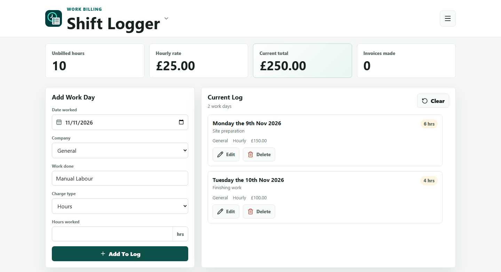

<p align="center">
  
</p>

<h1 align="center">Simply Pay</h1>

<p align="center">Log work, create invoices, and keep track of what people owe you.</p>

<p align="center"><a href="https://simply-pay.plexpoint.uk/"><strong>Open Simply Pay</strong></a></p>



## What’s inside

| Tool | What you can do |
| --- | --- |
| **Shift Logger** | Log hours or fixed charges by company, turn unbilled work into invoices, and export them as PDF or Word. |
| **Debt Tracker** | Track what people owe, apply payments to individual items, and see the remaining balance. |
| **PlexPoint Billing** | Sign in as a PlexPoint admin to manage plans, record customer payments, and review payment history. |

Shift Logger and Debt Tracker save to your browser. Google sign-in is available if you want to sync across devices. Open Settings to add the business and payment details you want on your invoices.

## Run locally

You need Python 3 to serve the app. From the repository root, run:

```sh
python -m http.server 8787 --bind 127.0.0.1
```

Open [http://localhost:8787](http://localhost:8787/). On Windows, you can also double-click [Start Billing App.bat](Start%20Billing%20App.bat).

The local server runs the browser app. Account sync uses Cloudflare Pages Functions and D1. PlexPoint Billing connects to the PlexPoint admin service.

## Tests

```sh
node --test tests/invoice-days.cjs
npm install --no-save --package-lock=false playwright
npx playwright install chromium
node --test tests/plex-session.cjs
```

The first test covers invoice work-day calculations. The browser test checks that PlexPoint sign-in survives reloads and restarts using mocked responses.
